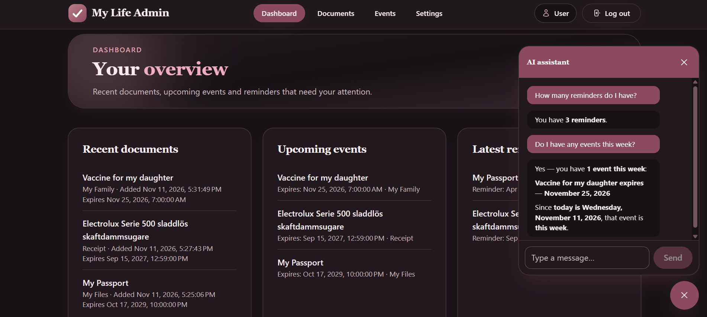
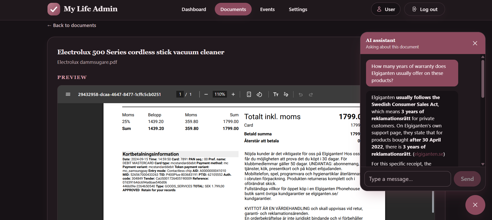
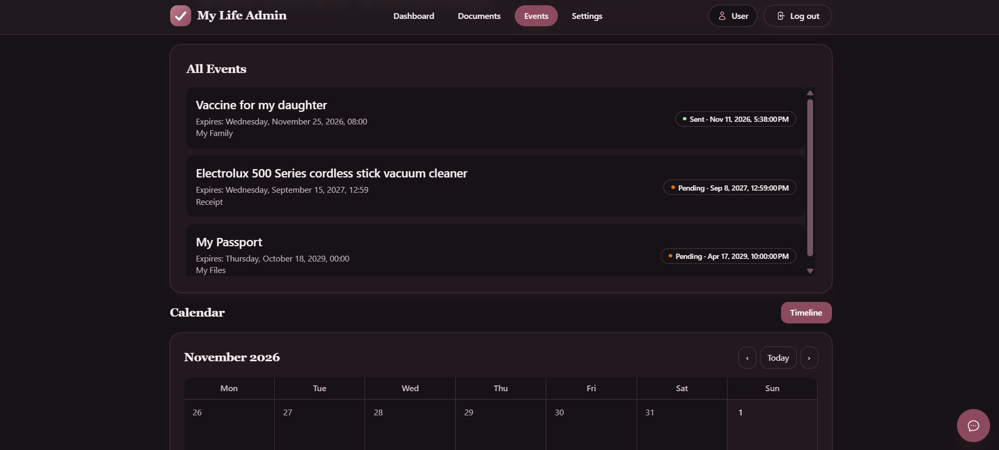
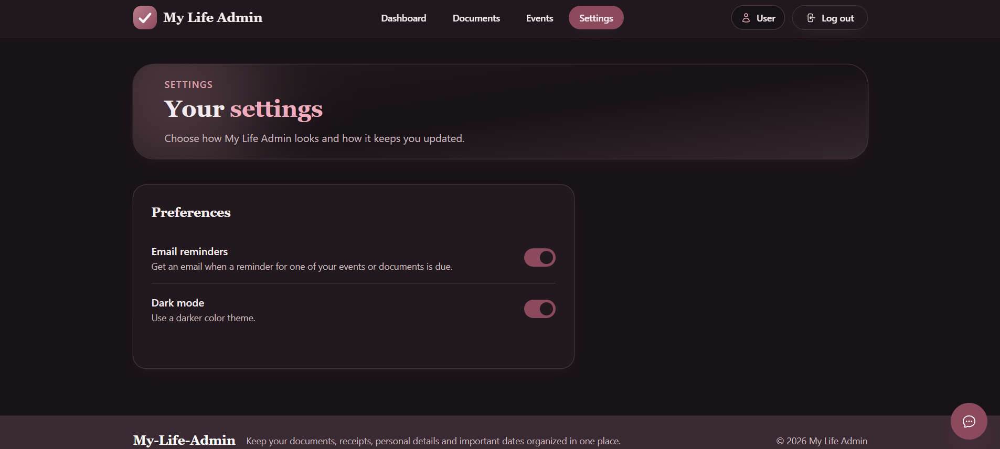

# MyLife Admin


#### Startsida


#### Dashboard



#### Dokument



#### Händelser



#### Inställningar



## Beskrivning

MyLife Admin är en webbapplikation för att samla vardagsadministration på ett ställe - dokument, viktiga datum och påminnelser.

Systemet låter användare skapa ett konto, ladda upp dokument, hålla koll på utgångsdatum via en kalender och få e-postpåminnelser.
Allt presenteras överskådligt via en dashboard, med möjlighet att ställa frågor till en AI-assistent om sina dokument.

Systemet låter användare:

- Skapa konto och logga in (JWT) för att komma åt sina personliga sidor
- Ladda upp, sök, visa, redigera, ladda ner och radera dokument
- Få en kalenderhändelse automatiskt skapad från ett dokuments utgångsdatum
- Skapa och hantera påminnelser med e-postaviseringar (bakgrundstjänst)
- Se en dashboard med nyligen tillagda dokument, kommande händelser och senaste påminnelser
- Chatta med en AI-assistent (globalt och per dokument) med webbsökning
- Mörkt läge och e-postnotiser som sparas per användare

---

## Funktioner

### Dokument

- Ladda upp dokument (PDF och bilder, max 10 MB)
- Sök, visa, redigera, ladda ner och radera dokument
- Utgångsdatum skapar automatiskt en kalenderhändelse
- AI-baserad dokumentanalys med automatisk textutvinning och metadat förslag (Azure Document Intelligence)
- Fillagring lokalt (utveckling) eller i Azure Blob Storage (produktion)

### Kalender & Händelser

- Skapa, uppdatera och ta bort händelser
- Automatisk händelse från dokuments utgångsdatum
- Filtrera händelser per tidsintervall

### Påminnelser

- Skapa och hantera påminnelser kopplade till event eller dokument
- E-postaviseringar skickas när en påminnelse infaller
- Bakgrundstjänst (`ReminderBackgroundService`) som skickar e-post

### Dashboard

- Nyligen tillagda dokument
- Kommande händelser
- Senaste påminnelser

### AI-chatt

- Global chatt och chatt per dokument
- Webbsökning om Azure OpenAI är konfigurerat
- Chathistorik sparas per dokument

### Konto & Inställningar

- Registrering och inloggning (JWT)
- Mörkt läge och e-postnotiser sparas per användare

### Gränssnitt

- Dark / Light mode
- Responsiv design (mobil, tablet, desktop)
- Bekräftelsedialoger för destruktiva åtgärder
- AI-chattwidget

---

## Arkitektur

Projektet är uppdelat i tre delar:

### Backend

- ASP.NET Core (minimal API)
- Entity Framework Core
- JWT-autentisering
- SQLite (development)
- SQL Server (production / Azure SQL)
- Azure Blob Storage (fillagring i produktion)
- Azure OpenAI + Azure Document Intelligence (valfria integrationer)

### Frontend

- Angular (standalone-komponenter)
- Tailwind CSS
- Responsiv UI
- Sidebar navigation
- AI-chattwidget

### Tester

- **Backend-tester** (xUnit) — `My-Life-Admin-Backend.Tests`
- **Frontend-tester** (Vitest) — i `My-Life-Admin-Frontend`
- **E2E-tester** (Playwright) — `E2E`

---

### API Endpoints

#### Auth

- `POST /api/auth/register` → Registrera konto
- `POST /api/auth/login` → Logga in (returnerar JWT)

---

#### Dokument

- `GET /api/documents/` → Hämta alla dokument
- `GET /api/documents/search` → Sök dokument
- `GET /api/documents/expiring` → Hämta dokument som snart går ut
- `GET /api/documents/{id}` → Hämta dokument
- `GET /api/documents/{id}/file` → Ladda ner dokumentfil
- `POST /api/documents/` → Ladda upp dokument
- `PUT /api/documents/{id}` → Uppdatera dokument
- `DELETE /api/documents/{id}` → Ta bort dokument
- `POST /api/documents/{id}/analyze` → Analysera dokument (AI)

---

#### Händelser

- `GET /api/events/` → Hämta alla händelser
- `GET /api/events/{id}` → Hämta händelse
- `POST /api/events/` → Skapa händelse
- `PUT /api/events/{id}` → Uppdatera händelse
- `DELETE /api/events/{id}` → Ta bort händelse

---

#### Påminnelser

- `GET /api/reminders/` → Hämta alla påminnelser
- `GET /api/reminders/pending` → Hämta väntande påminnelser
- `GET /api/reminders/{id}` → Hämta påminnelse
- `POST /api/reminders/` → Skapa påminnelse
- `PUT /api/reminders/{id}` → Uppdatera påminnelse
- `DELETE /api/reminders/{id}` → Ta bort påminnelse

---

#### Dashboard

- `GET /api/dashboard` → Hämta dashboardöversikt

---

#### Chatt

- `POST /api/chat/` → Skicka meddelande (globalt eller per dokument)
- `GET /api/chat/history` → Hämta chathistorik

---

#### Inställningar

- `GET /api/settings/` → Hämta användarinställningar
- `PUT /api/settings/` → Uppdatera användarinställningar

---

## Flöde i systemet

- Registrera konto
- Logga in (få JWT)
- Ladda upp dokument
- AI-analys ger förslag på metadata
- Utgångsdatum skapar automatiskt en händelse
- Skapa påminnelser med e-postavisering
- Övervaka allt via dashboarden

## Så här kör du programmet

```
cd My-Life-Admin-Backend
$env:Jwt__SigningKey = "byt-till-en-lang-slumpmassig-hemlighet"
dotnet run
```

Öppna en annan terminal för frontend:

```
cd My-Life-Admin-Frontend
npm install
npm start
```

Öppna `http://localhost:4200`.

## Konfiguration

- Lokal databas (development): SQLite `Data/mylife.db`
- JWT-signeringsnyckel: `Jwt__SigningKey` (miljövariabel eller user-secrets)
- Produktion:
  - Azure SQL Server (`ConnectionStrings__SqlServerConnection`)
  - Azure Blob Storage (`FileStorage__ConnectionString`)

### AI-chatt (Azure OpenAI)

- `Ai:Endpoint` - till exempel `https://din-resurs.openai.azure.com/openai/v1`
- `Ai:ApiKey` - API-nyckeln
- `Ai:Deployment` - deployment-namnet (inte modellnamnet)

Alla tre måste anges för att aktivera AI-chatten. Om alla är tomma svarar API:t med en platshållartext; om bara några är angivna startar inte API:t.

Valfritt: `Ai:SystemPrompt`, `Ai:MaxHistoryMessages` (standard 20) och `Ai:MaxOutputTokens` (standard 800).

```
dotnet user-secrets set "Ai:Endpoint" "https://din-resurs.openai.azure.com/openai/v1"
dotnet user-secrets set "Ai:ApiKey" "DIN_API_NYCKEL"
dotnet user-secrets set "Ai:Deployment" "DIN_DEPLOYMENT"
```

### Dokumentanalys (Azure Document Intelligence + Azure OpenAI)

Ger automatisk textutvinning och förslag på metadata vid dokumentuppladdning.

**Viktigt:** Dokumentanalysen använder två tjänster tillsammans:

1. **Azure Document Intelligence** (`DocumentIntelligence:Endpoint` + `DocumentIntelligence:ApiKey`) extraherar råtext från dokumentet (OCR).
2. **Azure OpenAI** (samma `Ai:Endpoint`, `Ai:ApiKey`, `Ai:Deployment` som ovan) strukturerar texten till titel, kategori, utgångsdatum och beskrivning.

Endast `DocumentIntelligence`-inställningarna är specifika; OpenAI-inställningarna återanvänds från chatt-konfigurationen. Valfritt: `DocumentIntelligence:ModelId` (standard `prebuilt-read`).

```
dotnet user-secrets set "DocumentIntelligence:Endpoint" "https://din-resurs.cognitiveservices.azure.com/"
dotnet user-secrets set "DocumentIntelligence:ApiKey" "DIN_API_NYCKEL"
```

### E-postpåminnelser (SMTP)

```
dotnet user-secrets set "Email:SmtpHost" "smtp.gmail.com"
dotnet user-secrets set "Email:SmtpPort" "587"
dotnet user-secrets set "Email:Username" "din-epost@gmail.com"
dotnet user-secrets set "Email:Password" "DITT_APPLOSENORD"
dotnet user-secrets set "Email:FromEmail" "din-epost@gmail.com"
```

## Publicering till Azure

Programmet deployas automatiskt via GitHub Actions (`.github/workflows/deploy.yml`).

Secrets som krävs:

- `AZURE_CREDENTIALS`
- `AZURE_SQL_CONNECTION_STRING`
- `AZURE_STORAGE_CONNECTION_STRING`
- `JWT_SIGNING_KEY`
- SMTP-, AI- och Document Intelligence-hemligheter (valfria)

Workflowen bygger frontend, publicerar backend, kopierar frontend till `wwwroot`, deployar till Azure Web App, konfigurerar app-inställningar och kör EF Core-migreringar.

---

## Tekniker

- ASP.NET Core (minimal API)
- Angular
- Tailwind CSS
- Entity Framework Core
- SQLite / SQL Server
- Azure (App Service, SQL, Blob Storage, OpenAI, Document Intelligence)
- JWT
- xUnit / Vitest / Playwright
- GitHub Actions

---

## Utvecklare

- Alaa Alsous
- Jesper Flodkvist Olofsson
- Johan Norgren
- Max Holmström
